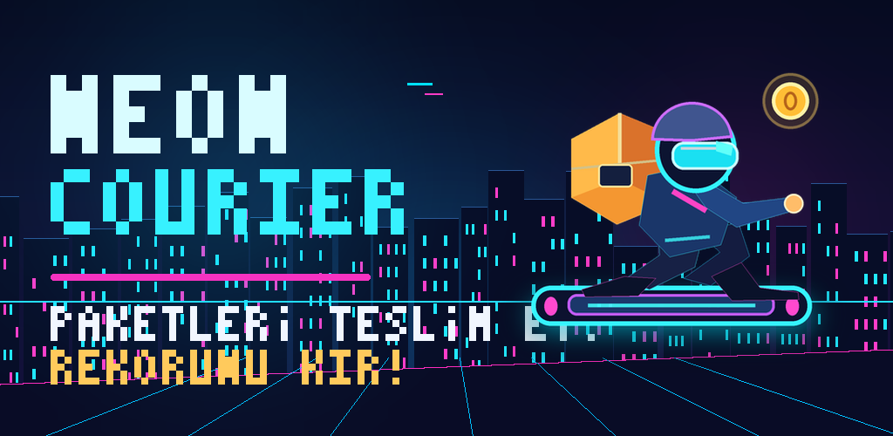
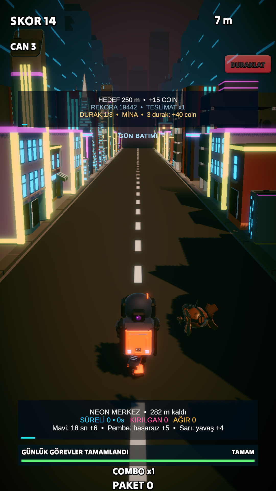
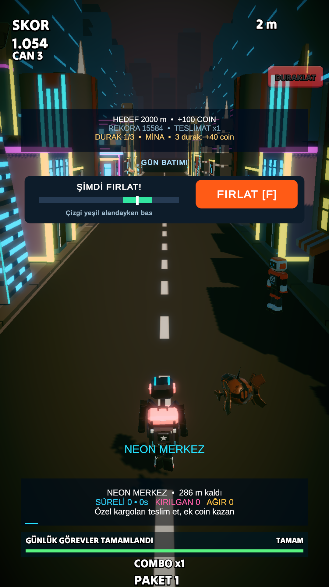
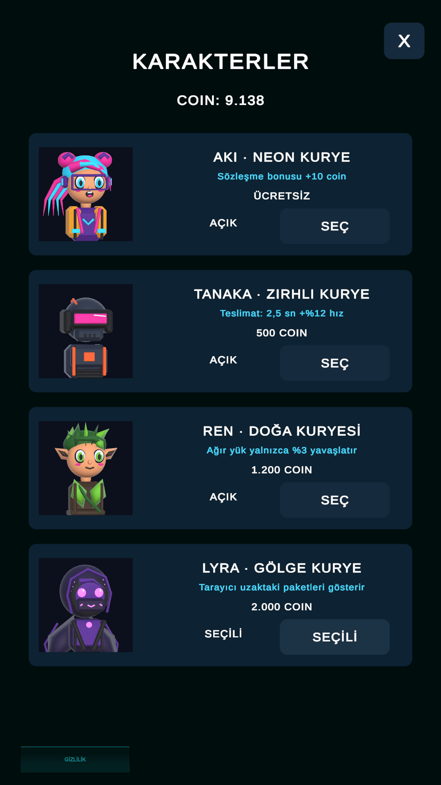

# Neon Courier

**Neon şehrinde koş, paketleri topla, teslimatı zamanında yap.**

Unity ve C# ile geliştirdiğim kurye temalı sonsuz koşu oyunu prototipi. Şerit değiştirme, zıplama ve kayma hareketlerini paket teslimatı, güçlendirmeler ve karakter ilerlemesiyle birleştiriyor.

**Geliştirici:** [Ulaş Cem Kılıç](https://github.com/Ucemklc) · **Unity:** 6000.3.20f1 · **Dil:** C# · **Render:** URP · **Girdi:** Unity Input System

[Kaynak kod arşivi](neon-courier-source.zip) · [Hareket sistemi](RunnerController.cs) · [Parkur sistemi](TrackManager.cs) · [Diğer oyunum: Burger Empire](https://github.com/Ucemklc/burger-empire)



## Oyun içinden

<p align="center">
  
  
  
</p>

**Koşu ve şehir rotası · Paket teslimatı · Karakter seçimi**

Üstteki kapak tanıtım çizimidir; üç dikey görüntü yerel geliştirme sürümlerinden alınmış gerçek oyun ekranlarıdır. Görüntüler farklı geliştirme aşamalarını yansıtabilir.

## Oynanış

- Şerit değiştir, engellerden kaç, zıpla ve kay.
- Paket topla ve teslimat noktalarında zamanlamanı kullan.
- Hoverboard ve güçlendirmelerle koşuyu sürdür.
- Günlük görevleri ve kariyer hedeflerini takip et; farklı karakterleri seç.

## Teknik olarak neler var?

| Sistem | İncelenecek kod | Öne çıkan nokta |
| --- | --- | --- |
| Oyuncu hareketi | [RunnerController.cs](RunnerController.cs) | CharacterController, şerit geçişi, zıplama, kayma ve dokunmatik girdi |
| Parkur yönetimi | [TrackManager.cs](TrackManager.cs) | Oyuncunun arkasında kalan parkur parçalarını tekrar kullanma |
| Oyun akışı | [GameManager.cs](GameManager.cs) | Koşu durumu ve oyun yönetimi |
| Kariyer | [CourierCareerProgress.cs](CourierCareerProgress.cs) | İlerleme ve kariyer hedefleri |
| Teslimat | [CourierTimedDelivery.cs](CourierTimedDelivery.cs) | Süreye bağlı teslimat sistemi |

Arşivde ek oyun sistemleri, projeye özel editör araçları ve mevcut play-check betikleri bulunur. Depo kökündeki C# dosyaları hızlı inceleme için seçilmiş kopyalardır.

## Arşiv ve proje kapsamı

[neon-courier-source.zip](neon-courier-source.zip) içinde:

```text
Assets/_Game/Scripts/    Oyun kodları ve editör araçları
Assets/_Game/Tests/      Mevcut kontrol betikleri
Packages/               Unity paket bağımlılıkları
ProjectSettings/        Proje ayarlarının kopyası
```

**Bu depo kaynak kod portföyüdür; tek başına çalıştırılabilir tam oyun projesi değildir.** Üçüncü taraf modellerin, animasyonların, müziklerin ve diğer hazır varlıkların yeniden dağıtım izni doğrulanmadığı için bu dosyalar, sahneler ve prefablar arşive eklenmedi. Kod ve editör araçları bu eksik varlıklara başvurabilir. Ekran görüntüleri tam yerel projeyi gösterir.

Yerel projede BackRock-NeonCity, BEDRILL, BTM_Assets, Cardboard Box (Rigged), Casual Game Sounds, COMICOMI, CyberWare, Layer Lab, StylizedCharacterPack, VoodooPlay ve 8-Bit RPG Adventure Music Pack gibi paketler kullanılır. Bu liste bir lisans veya yeniden dağıtım izni değildir.

## Geliştirme durumu

Geliştirme aşamasındaki prototip. Bu GitHub düzenlemesi sırasında oyun yeniden derlenmedi veya oynanarak test edilmedi. Önbellekler, yerel yedekler, imzalama dosyaları ve derleme çıktıları paylaşılmadı.

## English overview

A courier-themed Unity 6 / C# endless-runner prototype with lane movement, package deliveries, power-ups and character progression. The screenshots show the full local game. This public repository is a **source-code showcase**; third-party assets, scenes and prefabs are omitted, so the archive is not a standalone playable project.

## Kullanım hakları

Bu depoda açık kaynak lisansı verilmemiştir. Üçüncü taraf varlık ve bağımlılıklar kendi lisanslarına tabidir.
